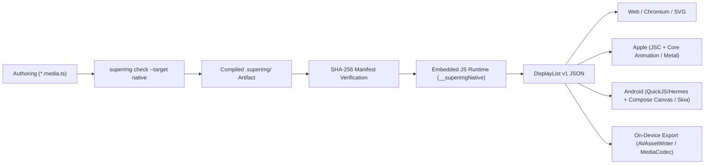

# SuperImg Cross-OS Architecture

SuperImg compiles deterministic media authored in TypeScript (`*.media.ts`) into self-contained `.superimg/` artifact bundles and renders them identically across **Web/Chromium**, **Apple (iOS/iPadOS/macOS)**, **Android (Jetpack Compose / JVM)**, and **Desktop** via the canonical **DisplayList v1** contract.

## 1. Unified Cross-OS Pipeline



### Pipeline Stages

1. **Authoring (`*.media.ts`)**: Templates use `@foxworth/superimg` primitives (`Frame`, `Stack`, `Text`, `Fill`, `Image`, `Vector`, `Scene`) and `ctx.director()` timelines.
2. **Compilation (`.superimg/`)**: `compileMediaArtifact` produces an atomic directory containing:
   - `artifact.json` (`@foxworth/superimg/artifact`, `schemaVersion: 0 | 1`) — top-level manifest, coordinates, runtime capability flags, file SHA-256 table, and composite `artifactHash`.
   - `media.json` (`@foxworth/superimg/media-ir`, `schemaVersion: 0`) — deterministic Media IR (canvas dimensions, clock `fps` / `durationSeconds` / `totalFrames`, phases, capabilities, provenance hashes).
   - `job.json` (`schemaVersion: 0`) — resolved effective `data`, `assetMap`, `resolvedAssets`, and font declarations.
   - `program.mjs` — bundled pure JavaScript module matching `media.hashes.programHash`.
   - `assets/` & `fonts/` — content-addressed vendored images, audio, and SFNT font files (`<sha256_16>-<filename>`).
   - `native-modules.json` (schema-1 only) — prepared native surface closures.
3. **Host Verification**: Before evaluating any JavaScript, native hosts (`ArtifactLoader` in `packages/superimg-kotlin` and equivalent Swift/Node loaders) verify path safety (rejecting `..`, `.`, leading `/`, backslashes, URL tokens, and control characters), byte lengths, per-file SHA-256 digests, `artifactHash = sha256(sorted(path + ":" + sha256).join("\n"))`, and `job`/`manifest`/`media` clock & coordinate consistency.
4. **Sampling (`__superimgNative`)**: The host drives `globalThis.__superimgNative.sampleArtifact(...)` per frame/seek to obtain a deterministic `DisplayListFrame`.
5. **Native Rasterization & Export**: Platform renderers paint `DisplayListFrame` onto retained or immediate-mode GPU surfaces (`CALayer` / CoreGraphics / Metal on Apple; Compose `DrawScope` / Android `Canvas` / Skia on Android) or encode offscreen frames directly into H.264 MP4 (`AVAssetWriter` / `MediaCodec`).

---

## 2. Canonical DisplayList v1 JSON Schema

All native runtimes share the byte-for-byte **DisplayList v1** JSON contract validated by `DisplayListFrame.validate()` in both [DisplayList.swift](../packages/superimg-swift/Sources/SuperImg/DisplayList.swift) and [DisplayList.kt](../packages/superimg-kotlin/src/commonMain/kotlin/dev/superimg/DisplayList.kt).

### `DisplayListFrame` (Root)

| Field | Type | Required | Constraints / Notes |
|---|---|---|---|
| `kind` | `string` | Yes | Must equal `"@foxworth/superimg/display-list"` |
| `schemaVersion` | `number` | Yes | Must equal `1` |
| `width` | `number` | Yes | Finite, `> 0` (authored logical canvas width) |
| `height` | `number` | Yes | Finite, `> 0` (authored logical canvas height) |
| `ops` | `DisplayOp[]` | Yes | Ordered back-to-front draw operations |
| `anchors` | `DisplayAnchor[]` | Yes | Named spatial attachment points (`[{ entity, name, x, y }]`) |
| `issues` | `DisplayIssue[]` | Yes | Non-fatal lowering diagnostics (`[{ nodeId?, code, message }]`) |

### `DisplayOp` Common Fields

| Field | Type | Required | Constraints / Notes |
|---|---|---|---|
| `id` | `string` | Yes | Non-empty, unique across `ops` in the frame |
| `kind` | `string` | Yes | Discriminator: `"rect" \| "ellipse" \| "path" \| "image" \| "text"` |
| `bounds` | `DisplayBounds` | Yes | `{ x, y, width, height }`; all finite, `width >= 0`, `height >= 0` |
| `matrix` | `DisplayMatrix` | No | 2D affine `{ a, b, c, d, e, f }` mapping `[x', y', 1] = [a c e; b d f; 0 0 1] * [x, y, 1]` |
| `opacity` | `number` | Yes | Finite, clamped in `[0.0, 1.0]` |
| `blendMode` | `string` | No | `"normal" \| "multiply" \| "screen" \| "overlay"` |
| `clips` | `DisplayClip[]` | No | Nested clip rectangles `[{ x, y, width, height, radius? }]` |

### `DisplayOp` Variant Fields

| `kind` | Field | Type | Required | Notes |
|---|---|---|---|---|
| `"rect"` | `fill` | `DisplayPaint` | No | Solid, linear gradient, or radial gradient fill |
| `"rect"` | `stroke` | `DisplayStroke` | No | Outline stroke |
| `"rect"` | `radius` | `number` | No | Uniform corner radius (`>= 0`) |
| `"ellipse"` | `fill` | `DisplayPaint` | No | Inscribed inside `bounds` |
| `"ellipse"` | `stroke` | `DisplayStroke` | No | Outline stroke |
| `"path"` | `d` | `string` | Yes | SVG path command string (`M/L/H/V/C/S/Q/T/A/Z`) |
| `"path"` | `fill` | `DisplayPaint` | No | Path fill paint |
| `"path"` | `fillRule` | `string` | No | `"nonzero" \| "evenodd"` (default `"nonzero"`) |
| `"path"` | `stroke` | `DisplayStroke` | No | Path stroke |
| `"image"` | `asset` | `string` | Yes | Key in artifact `assetMap` / host sprite table |
| `"image"` | `fit` | `string` | Yes | `"cover" \| "contain" \| "fill"` |
| `"image"` | `pixelArt` | `boolean` | No | When `true`, sample with nearest-neighbor filtering |
| `"image"` | `radius` | `number` | No | Optional rounded clip radius (`>= 0`) |
| `"text"` | `lines` | `DisplayTextLine[]` | Yes | Pre-wrapped lines `[{ text, x, y, baselineY, width }]` |
| `"text"` | `fontFamily` | `string` | Yes | Font family name |
| `"text"` | `fontSize` | `number` | Yes | Logical px, finite `> 0` |
| `"text"` | `fontWeight` | `number (int)` | Yes | CSS weight `1..1000` (e.g. `400`, `700`) |
| `"text"` | `fontStyle` | `string` | Yes | `"normal" \| "italic"` |
| `"text"` | `letterSpacing` | `number` | No | Additional tracking in logical px |
| `"text"` | `lineHeight` | `number` | No | Line box height in logical px (`> 0`) |
| `"text"` | `align` | `string` | Yes | `"left" \| "center" \| "right"` |
| `"text"` | `color` | `string` | Yes | `#rrggbb` or `#rrggbbaa` hex string |
| `"text"` | `metricsExact` | `boolean` | Yes | `true` when measured from real SFNT font tables |

### `DisplayPaint`, `DisplayStroke`, `DisplayAnchor`, and `DisplayIssue`

```jsonc
// DisplayPaint (solid)
{ "kind": "solid", "color": "#rrggbb[aa]" }

// DisplayPaint (linearGradient — coordinates normalized 0..1 to op.bounds)
{
  "kind": "linearGradient",
  "x1": 0.0, "y1": 0.0, "x2": 1.0, "y2": 1.0,
  "stops": [{ "color": "#0f172a", "offset": 0.0 }, { "color": "#1e293b", "offset": 1.0 }]
}

// DisplayPaint (radialGradient — cx, cy, r normalized 0..1 to op.bounds)
{
  "kind": "radialGradient",
  "cx": 0.5, "cy": 0.5, "r": 0.5,
  "stops": [{ "color": "#38bdf8ff", "offset": 0.0 }, { "color": "#38bdf800", "offset": 1.0 }]
}

// DisplayStroke
{
  "color": "#ffffff80",
  "width": 2.0,
  "lineCap": "round",      // optional: "butt" | "round" | "square"
  "lineJoin": "round",     // optional: "miter" | "round" | "bevel"
  "dashArray": [4.0, 2.0], // optional
  "dashOffset": 1.0        // optional
}
```

- **`DisplayAnchor`**: `{ "entity": "nell", "name": "talk", "x": 540.0, "y": 790.0 }` — coordinates are in authored artwork space; hosts map them through the viewport fit transform and return `null` when out of bounds.
- **`DisplayIssue`**: `{ "nodeId": "headline", "code": "FONT_FALLBACK", "message": "..." }`.

---

## 3. Canonical `__superimgNative` JS Engine Bridge

Every native host embeds a lightweight JS engine and invokes the exact same global bridge on `globalThis.__superimgNative`:

```ts
interface SuperImgNativeBridge {
  loadArtifact(input: {
    programCode: string;
    media: MediaIR;
    job: MediaJob;
    fonts: Record<string, string>; // font token/path -> base64 or logical registration key
  }): string; // returns opaque artifact handle ID

  sampleArtifact(
    id: string,
    request: {
      seconds: number;
      frame: number;
      width: number;
      height: number;
      scale: number;
      safeArea: { top: number; left: number; bottom: number; right: number };
      reduceMotion: boolean;
      data?: Record<string, unknown>;
      edition?: string;
    },
  ): DisplayListFrame;

  disposeArtifact(id: string): void;
}
```

### Platform Engine Bindings

| Platform | JS Engine | Bridge Implementation | Threading Model |
|---|---|---|---|
| **Apple (iOS / macOS)** | `JavaScriptCore` (`JSContext`) | `SuperImgScene` actor (`packages/superimg-swift`) | Serial Swift `actor` off the main thread |
| **Android / KMP** | QuickJS (`quickjs-kt` / JNI) or Hermes | `SuperImgJsEngine` / `QuickJsEngineAdapter` + `SuperImgArtifactSession` (`packages/superimg-kotlin`) | Single-threaded VM `CoroutineDispatcher` guarded by `Mutex` |
| **Web / Node / Edge** | V8 / Browser Worker | Direct in-process JS evaluation / `@foxworth/superimg/runtime` | Main thread or Worker |

---

## 4. Platform Capability Matrix

| Feature | Web (Chromium) | Apple (`superimg-swift`) | Android (`superimg-kotlin`) |
|---|---|---|---|
| `Frame`, `Stack`, `Spacer`, `Safe` | Full | Full (via DisplayList) | Full (via DisplayList) |
| `Fill` (solid, linear, radial gradients) | Full | DisplayList v1 `DisplayPaint` | Full (`LinearGradient` / `RadialGradient`) |
| `Vector` (`rect`, `circle`, `ellipse`, `path`, `fillRule`) | Full | DisplayList v1 + CoreGraphics | Full (`SvgPathParser` + `Path`) |
| `Image` (`cover`, `contain`, `fill`, `pixelArt`, `radius`) | Full | DisplayList v1 + `CALayer` | Full (`Bitmap` + `FilterQuality`) |
| `Text` (pre-wrapped lines, weights, italic, letterSpacing) | Full | DisplayList v1 + CoreText | Full (`Typeface` + `Canvas.drawText`) |
| Clips, 2D affine matrices, opacity, blend modes | Full | CoreGraphics / Core Animation | `Canvas.clipPath` / `Matrix` / `saveLayer` |
| Anchors (`onFrameApplied`) | DOM / Scene snapshot | `SuperImgAppliedFrame.anchor` | `SuperImgAppliedFrame.anchor` |
| `Html()`, `Video()`, `Plate()`, CSS / Tailwind | Full | Browser-only (rejected) | Browser-only (rejected) |
| Off-device / On-device MP4 Export | Playwright + FFmpeg / MediaBunny | `AVAssetWriter` | `SuperImgMediaCodecExporter` (`MediaCodec` + `MediaMuxer`) |

---

## 5. Portability Rules (`superimg check --target native`)

Native renderers execute in a browser-free JS VM without DOM, CSS layout engines, or HTML `<video>` decoders. `checkNativePortability` (in [classify.ts](../packages/superimg-stdlib/src/tree/classify.ts)) enforces portability before packaging:

### Native-Portable
- Layout primitives: `Frame`, `Stack`, `Spacer`, `Safe`, `Fill`.
- Typed vector nodes: `Vector`, `VectorGroup`, `VectorRect`, `VectorCircle`, `VectorEllipse`, `VectorPath`, `VectorLine`, `VectorPolygon`, `VectorPolyline`, `VectorLinearGradient`, `VectorRadialGradient`, `VectorClip`.
- `Image` referencing vendored `ctx.asset(...)` keys (`fit: "cover" | "contain" | "fill"`).
- `Text` with explicit `fontFamily`, `fontSize`, `fontWeight`, `fontStyle`, `color`, and vendored `.ttf`/`.otf`/`.woff` fonts.
- `Scene` / `Instance` / named anchors (`entity`, `name`).
- `opacity`, `blendMode` (`normal`, `multiply`, `screen`, `overlay`), `clips`, and 2D affine transforms.

### Browser-Only (Rejected by `--target native`)
- `Html`, `foreignObject`, `Video`, `Plate` (require Chromium DOM/media pipeline).
- `tailwind`, `stylesheets`, `inlineCss`, `className` / `class`, or arbitrary raw `style` objects.
- Non-color `background` CSS expressions (e.g. CSS `url(...)`, multi-layer `conic-gradient`).
- `kenBurns` prop and unsupported CSS `filter` effects (other than simple blur where lowered).
- Un-vendored remote network assets (`requiresNetwork: true` fails strict offline native verification).

---

## 6. Font Metric Parity (`parseFontMetrics` + CoreText / Skia)

Cross-OS typography avoids platform layout drift by measuring and line-breaking text **once** during tree lowering, rather than letting UIKit/CoreText and Android `StaticLayout` re-wrap lines independently:

1. **JS-Side SFNT Measurement**: `parseFontMetrics` in `@foxworth/superimg/stdlib/svg` ([font-metrics.ts](../packages/superimg-stdlib/src/svg/font-metrics.ts)) reads raw TTF/OTF/WOFF1 bytes directly from the `.superimg/fonts/` bundle (`head`, `hhea`, `OS/2`, `hmtx`, `cmap`, and `kern` format 0).
2. **Pre-Wrapped `DisplayTextLine` Emission**: `TextMeasurer` computes line breaks, line widths, `x` (respecting `left`/`center`/`right` alignment), `y`, and exact `baselineY` in authored coordinates, setting `metricsExact: true` when real SFNT font tables were available (`false` when falling back to the `0.55em` heuristic).
3. **Native Baseline Rendering**:
   - **Apple**: Renders each `DisplayTextLine` at `(line.x, line.baselineY)` using CoreText (`CTFont` created from the vendored font `CGDataProvider`) so glyph baselines match JS metrics to sub-pixel precision.
   - **Android**: `SuperImgTypefaceRegistry.fromArtifact` materializes verified `.superimg/fonts/` bytes into `android.graphics.Typeface` instances, and `DisplayListAndroidRenderer` draws each `DisplayTextLine` directly at `(line.x, line.baselineY)` with `Paint.Align.LEFT` and `letterSpacing = px / fontSize` (converting CSS px into Android `Paint` em units).

---

## 7. On-Device Video Export (`AVAssetWriter` vs `MediaCodec`)

Both mobile runtimes support deterministic offline MP4 encoding directly from the verified `.superimg/` artifact and `__superimgNative` sampler:

| Concern | Apple (`AVAssetWriter`) | Android (`SuperImgMediaCodecExporter`) |
|---|---|---|
| **Codec & Container** | `AVAssetWriter` (`AVFileType.mp4`) + `AVVideoCodecType.h264` | `MediaCodec` (`video/avc`, `COLOR_FormatSurface`) + `MediaMuxer` (`MUXER_OUTPUT_MPEG_4`) |
| **Pixel Input** | `AVAssetWriterInputPixelBufferAdaptor` (`CVPixelBuffer` + `CGContext`) | `codec.createInputSurface()` + `Surface.lockHardwareCanvas()` |
| **Frame Timing (PTS)** | `CMTime(value: frameIndex, timescale: fps)` | Deterministic `round((frameIndex * 1_000_000.0) / fps)` with `KEY_MAX_B_FRAMES = 0` |
| **Dimensions** | Authored or requested width/height | Even-aligned `width`/`height` (`x and ~1`) required by hardware H.264 encoders |
| **Atomicity** | Write to `.tmp` sibling, atomic `FileManager.replaceItemAt` | Write to `.tmp` sibling, delete partial on error, atomic rename on EOS |
| **Cancellation** | `Task.checkCancellation()` per frame | `coroutineContext.ensureActive()` per frame |

---

## 8. Physical-Device Profiling Playbook

### Frame Budgets

| Target Refresh | Frame Budget | Typical Sample (JS VM) | Typical Rasterize | Safe Margin |
|---|---|---|---|---|
| **60 Hz** | **16.67 ms** | 0.5 – 2.5 ms | 1.0 – 4.0 ms | ~10 ms |
| **120 Hz (ProMotion / LTPO)** | **8.33 ms** | 0.4 – 1.8 ms | 0.8 – 2.5 ms | ~4 ms |

### Coalesced Sampling Discipline

Both `SuperImgCanvas.swift` (UIKit `CADisplayLink`) and `CoalescedFrameScheduler` in `packages/superimg-kotlin` (Compose `withFrameNanos`) enforce **single-in-flight, latest-pending** execution:

1. At most **one** `sampleArtifact` call executes in the JS VM at any time (`busy = true`).
2. If new vsync ticks, scrub seeks, or state updates arrive while the JS VM is busy, they overwrite a single `pending` slot—intermediate frames are dropped immediately without queueing backpressure.
3. Viewport resizes and state updates increment `generation` / `revision`; any in-flight sample completing with a stale `generation` or `revision` is discarded before touching the canvas.

### Measuring on Physical Devices

Use `SuperImgBenchmark` (available in both `packages/superimg-swift` and `packages/superimg-kotlin`) during release-mode device runs (never debug-mode JIT/Compose debug builds):

```kotlin
val benchmark = SuperImgBenchmark()
// Pass into SuperImgCanvas(..., benchmark = benchmark)
// Inspect after 300+ frames:
println("p50=${benchmark.p50Milliseconds}ms p95=${benchmark.p95Milliseconds}ms drops60=${benchmark.droppedFrameBudget(60)}")
```

### Escalation Path: When to Move Beyond Retained Layers / Canvas

1. **Retained Layers (`CALayer`) / Immediate Android `Canvas` (Default)**:
   - Ideal for **< 150 ops/frame**, UI overlays, character scenes, motion typography, and standard gradients/clips.
   - Zero shader compilation overhead and native vector crispness at any DPI.
2. **Pre-Rasterized Sprite Atlases / Static Caching**:
   - Escalate here when a complex static background contains **> 200 vector path ops** or expensive blur/gradient stacks that do not morph per frame.
3. **Custom GPU Backend (Metal / Skia Ganesh-Graphite / Vello)**:
   - Escalate only when profiling shows **rasterization > 4.5 ms at p95** on physical devices due to:
     - Particle systems or procedural noise exceeding ~500 dynamic ops/frame,
     - Multi-pass custom fragment shaders / displacement filters, or
     - Heavy per-frame path boolean/morph tessellation where GPU compute path rendering (Vello / Metal compute) eliminates CPU path upload bottlenecks.
